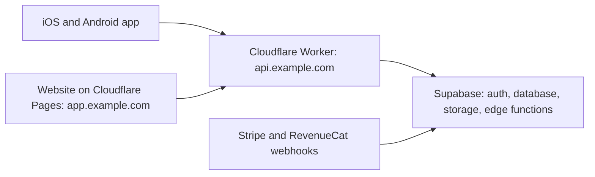

# GoldenTongue

**Start here (website with AI):** `docs/LAUNCH_WEBSITE.md` and `scripts/launch_website.sh` (fill `launch/.env`, run with `DRY_RUN=1` first).
Then `docs/LAUNCH_CHECKLIST.md` (order of work for Cloudflare, App Store and Google Play) and `docs/AUDIT.md`
(what was verified, what was fixed, what is still untested).

**Access rules (pay first):** an account is required and a membership must be paid before anything opens.
Signed-out visitors see the login, signed-in accounts without a membership see only the paywall (app) or the upgrade
page (website), and the database hides all content from them. Admin accounts (`select public.grant_admin('you@example.com');`)
get full access without paying and without limits. Account deletion is built in (required by both stores).

One-command helpers: `scripts/launch_website.sh` (whole website launch incl. AI), `scripts/preflight.sh` (checks your settings and keys), `scripts/make_admin.sh` (grants admin), `scripts/deploy_backend.sh` (database, functions), `scripts/deploy_cloudflare.sh` (gateway and
Flutter web), `cloudflare/members-site/scripts/deploy.sh` (members website), `scripts/setup_mobile.py` (permissions and
deep link in the iOS and Android projects), `scripts/verify_deployment.sh` (checks the live deployment from outside).


Premium black-and-gold communication coaching app.
Status: first production-oriented skeleton. It has not been compiled or run yet; expect to fix small
issues on first build.

## What is included
- Line Library screen (13 categories, search, favorites, detail view with scores, example conversation,
  alternatives and recovery) reading the `library` lines from the database.
- Premium: paywall screen, premium gate on Deep Talk and Business, RevenueCat in-app purchases on
  iOS and Android, Stripe Checkout on web, webhook functions and entitlement logic in the database.
- Flutter app: auth (email, Google, Apple), luxury theme, 6-tab navigation, Home dashboard,
  Social (search, favorites, popularity), Deep Talk, Business, Speak Better, AI Coach chat, Profile.
- Supabase: schema with row level security, server-side functions (`consume_ai_request`,
  `complete_challenge`, `is_premium`), seed data, `coach` edge function.

## Not included yet
- Voice-free items below; billing is implemented but needs your store and Stripe accounts (see Billing).
- Localization, end-to-end tests with real AI calls, load tests.
- Tests, CI and localization.

## Setup (mobile and local)
1. Requirements: Flutter 3.27 or newer, Supabase CLI, a Supabase project, an OpenAI API key.
2. Generate the platform folders in this directory:
   `flutter create --platforms=ios,android --org io.goldentongue .`
   (keeps existing `lib/` and `pubspec.yaml`), then `flutter pub get`.
3. Database:
   ```
   supabase link --project-ref YOUR_REF
   supabase db push
   psql "$DATABASE_URL" -f supabase/seed.sql   # or paste seed.sql in the SQL editor
   psql "$DATABASE_URL" -f supabase/seed_line_library.sql   # 325 pickup lines with details
   psql "$DATABASE_URL" -f supabase/seed_curated.sql   # 50 openers + 50 flirt techniques
   ```
4. Edge function:
   ```
   supabase secrets set OPENAI_API_KEY=sk-... COACH_MODEL=gpt-4o-mini FREE_DAILY_LIMIT=5
   supabase functions deploy coach voice-analyze simulator blueprint exercise-evaluate create-checkout delete-account
   (or run scripts/deploy_backend.sh, which does steps 3 to 4 including the webhooks)
   ```
5. Auth providers: enable Email, Google and Apple in Supabase Auth settings and add the redirect URL
   `io.goldentongue://login-callback`. Add the matching URL scheme to
   `ios/Runner/Info.plist` and an intent filter to `android/app/src/main/AndroidManifest.xml`.
   Apple sign-in also needs the Sign in with Apple capability in Xcode.
6. Run:
   ```
   flutter run \
     --dart-define=SUPABASE_URL=https://YOUR-PROJECT.supabase.co \
     --dart-define=SUPABASE_ANON_KEY=YOUR_ANON_KEY
   ```

## Security notes
- The OpenAI key lives only in edge function secrets. The app uses only the Supabase anon key.
- Every table has row level security. `subscriptions`, `ai_usage`, `gamification` and `skill_scores`
  are written only by security-definer functions or the service role.
- Entitlements and the free daily limit are enforced on the server (`consume_ai_request`).
- The coach requires `profiles.adult_confirmed`, runs input moderation and returns validated JSON.
- Restrict the CORS origin in `supabase/functions/coach/index.ts` if you add a web client.

## Structure
(cloudflare/worker = API gateway, web_extras + scripts/setup_web.sh = Pages files, .github/workflows/deploy.yml = deploy)
```
lib/
  main.dart            app entry, Supabase init
  app/                 theme (colors, spacing, typography), router with auth redirect
  core/                env, ranks, data providers
  widgets/             GoldButton, AppCard, ScoreCard, GoldProgress, TagChip
  features/            auth, shell (bottom nav), home, social, sections, coach, profile
supabase/
  migrations/0001_init.sql
  migrations/0002_line_library.sql
  migrations/0003_billing.sql
  migrations/0004_curated_lists.sql
  migrations/0005_studio.sql
  migrations/0006_progress.sql
  migrations/0007_exercises.sql
  migrations/0008_admin.sql
  migrations/0009_paid_access.sql
  migrations/0010_sections.sql
  migrations/0011_fair_use.sql   daily fair-use cap for members, unlimited for admins
  seed_sections.sql       Deep Talk, Business and Speak Better cards (members only)
  seed.sql
  seed_line_library.sql   325 lines, 13 categories, with details
  seed_curated.sql        50 best openers + 50 flirt techniques with details
  seed_exercises.sql      30 Deep Talk and Business practice exercises
  functions/_shared (auth, LLM, moderation, transcription helpers, logic.ts + logic_test.ts)
  tests/database/core.test.sql   pgTAP tests
  functions/coach, voice-analyze, simulator, blueprint, exercise-evaluate, create-checkout, stripe-webhook, revenuecat-webhook
  (each AI function is split into handler.ts with injected dependencies, handler_test.ts and a thin index.ts)
```

## Pickup line library data
`lines` rows with `collection = 'library'` hold the 325 lines (25 per category). Each row has `why`,
`recovery`, `alternatives` (2 other lines), `example` (a short sample conversation as JSON) and
`scores` (effectiveness, confidence, difficulty). The scores are estimates (`scores.estimated = true`)
and the example conversation is a generic template; replace both with measured or hand-written
content over time. Query example:
`select * from lines where collection = 'library' and category = 'Funny' order by popularity desc;`

## Billing
Mobile apps must sell digital subscriptions through in-app purchase (App Store, Google Play). The app uses
RevenueCat for that. The web build uses Stripe Checkout (cards, Apple Pay and Google Pay when enabled).
The database (`subscriptions` table, written only by the webhook functions) is the source of truth;
the app asks the server via `is_premium_self`.

1. Create three subscription products with these ids in App Store Connect and Google Play:
   `gt_premium_monthly`, `gt_premium_quarterly`, `gt_premium_yearly`. No free trial or introductory offer.
2. In RevenueCat: add both apps, create an entitlement `premium`, an offering with the three packages
   (monthly, three month, annual) and copy the public SDK keys.
3. RevenueCat webhook: URL `https://YOUR-PROJECT.supabase.co/functions/v1/revenuecat-webhook`,
   Authorization header = a long random value, then
   ```
   supabase secrets set REVENUECAT_WEBHOOK_AUTH=that-value
   supabase functions deploy revenuecat-webhook --no-verify-jwt
   ```
4. Stripe (web): create three recurring prices, then
   ```
   supabase secrets set STRIPE_SECRET_KEY=sk_... STRIPE_WEBHOOK_SECRET=whsec_... \
     STRIPE_PRICE_MONTHLY=price_... STRIPE_PRICE_QUARTERLY=price_... STRIPE_PRICE_YEARLY=price_... \
     APP_URL=https://your-web-app.example
   supabase functions deploy create-checkout
   supabase functions deploy stripe-webhook --no-verify-jwt
   ```
   Add the webhook endpoint in Stripe with the three `customer.subscription.*` events and API version 2024-06-20.
5. Run the app with the extra keys:
   `--dart-define=REVENUECAT_IOS_KEY=appl_... --dart-define=REVENUECAT_ANDROID_KEY=goog_...`
6. Test with App Store sandbox accounts, Google Play license testers and Stripe test mode before launch.

Notes
- Gating of Deep Talk and Business is a UI gate; that content is bundled in the app. To protect content
  for real, move it to the database with a `premium` flag and enforce it with row level security.
- Pricing is shown from the store when available and falls back to 14.99 / 34.99 / 99.99 USD.
- Terms of use and privacy policy links are required by the stores; add them to the paywall before release.
- The code has not been compiled or run. `purchases_flutter` APIs change between major versions; if a call
  does not compile, check the version in `pubspec.yaml` against the RevenueCat Flutter docs.

## Curated openers and flirt techniques
`lines` rows with `collection = 'opener'` (50) or `'flirt'` (50). Columns used: `category` (group),
`title` (technique name, flirts only), `text`, `position`, `best_situation`, `difficulty`,
`confidence_required`, `responses` (2 examples), `voice_delivery`, `red_flags`, `alternatives`,
`success_estimate`. `best_situation`, `difficulty`, `confidence_required` and `voice_delivery` are set per
group; `responses`, `red_flags` and the alternative version are written per entry.
`success_estimate` is a starting estimate (`estimated = true`), not a measured rate; replace it with real
feedback data over time. The Social screen links to both lists (`/openers`, `/flirts`).

## Studio (voice analysis, simulator, Charm Blueprint)
- Migration `0005_studio.sql`: extends `voice_analyses`, adds the private `voice` storage bucket (one folder per
  user), `can_analyze_voice()` (free: 1 per week, premium: unlimited), message feedback, and `blueprints`.
- Edge functions: `voice-analyze` (audio in storage -> Whisper transcript -> AI scores; audio is deleted after
  transcription), `simulator` (start, turn, end; premium only), `blueprint` (premium only).
  Deploy: `supabase functions deploy voice-analyze simulator blueprint` (secrets are the same `OPENAI_API_KEY`
  and optional `COACH_MODEL`).
- Flutter: Home -> Studio cards open `/studio/voice`, `/studio/simulator`, `/studio/blueprint`.
  Add microphone permissions: iOS `NSMicrophoneUsageDescription` in `Info.plist`, Android
  `<uses-permission android:name="android.permission.RECORD_AUDIO"/>`.
- On-device voice metrics: the app records a 16 kHz PCM stream (`record`), measures pitch, pitch variety,
  pauses and energy variation locally (`acoustics.dart`), uploads a WAV file and sends the metrics with it. The
  server validates them and adds pace and filler words from the transcript. Metrics the device could not measure
  are sent as missing and the analysis says so.
- Simulator voice call mode: choose "Voice call" before starting. The character speaks (`flutter_tts`) and the
  microphone opens automatically afterwards (`speech_to_text`); you can also type. Needs the microphone and speech
  recognition permissions: iOS `NSMicrophoneUsageDescription` and `NSSpeechRecognitionUsageDescription`, Android
  `RECORD_AUDIO` plus a `<queries>` entry for `android.speech.RecognitionService`.
- Pitch is estimated with a simple autocorrelation method. It is good for relative variety, not a lab measurement.
- Free users share one daily AI counter between coach and other AI features; the simulator and Blueprint are premium.
- Not compiled or run yet. The `record` package API changes between major versions; check its docs if a call fails.

## Progress dashboard
`/progress` (Home -> Full progress) shows the average of all skills with data, a radar chart, a 7 day activity chart
and, per skill, the current score, the change this week and a trend line (last 90 days). Scores come from
`skill_scores`: daily challenges, voice analyses and finished simulator sessions write to it. The AI edge functions
call `record_skill_scores` (migration 0006) with the service role, so the app cannot write scores directly. New
results are blended with earlier ones (60 percent old, 40 percent new) so one session does not swing the score.
Deep Talk and Business are scored by the practice exercises (below), so all seven skills can fill.

## Practice exercises (Deep Talk and Business)
Each Deep Talk category (8) and Business area (7) has two exercises in `exercises` (30 in total,
`seed_exercises.sql`, migration `0007_exercises.sql`). Open a category, tap Practice, write your answer, and the
`exercise-evaluate` function (premium) scores it against three criteria stored in the database, returns what worked,
the most useful improvement and a stronger version. The attempt is saved and the `deep_talk` or `business` skill score
and 20 XP are recorded server-side. The criteria names come from the database, never from the model, and the model's
scores are clamped to 0..100. Limit: 20 evaluations per day (`EXERCISE_DAILY_LIMIT`).
Deploy: `supabase functions deploy exercise-evaluate` and
`psql "$DATABASE_URL" -f supabase/seed_exercises.sql`.

## Tests
- Edge functions: `deno test supabase/functions`. Handler tests call each function's handler with fake dependencies
  (fake Supabase client, canned AI answers, no network) and cover: CORS and methods, authentication, adults-only,
  premium gates (402), free limits (429), input validation, moderation, ownership of sessions and audio paths,
  storing and deleting data, server-side score recording, sanitizing of AI output, webhook authorization and event
  mapping. Functions covered: coach, voice-analyze, simulator, blueprint, exercise-evaluate, revenuecat-webhook, plus
  unit tests for `_shared/logic.ts`. 64 tests ran green under Deno with a small shim for `Deno.test` and the assert
  import; they have not yet been run under Deno itself. `stripe-webhook` and `create-checkout` are not covered
  (they need the Stripe library).
- Database (pgTAP): `supabase test db` runs `supabase/tests/database/core.test.sql` (42 checks: signup trigger,
  premium rules incl. grace period, free AI limit, weekly voice limit, row level security, score blending, and for
  exercises: unique titles, valid tracks, read access, no client writes to attempts, own attempts only, deep_talk and
  business score recording, admin rights and admin invisibility).
- Flutter: `flutter test` (ranks, WAV header, pitch and pause measurement on synthetic tones, weekly delta, exercise
  result parsing and score labels, exercise screen with local validation).
- CI: `.github/workflows/ci.yml` runs all three plus `flutter analyze` and `deno check`.
- Worker: `cd cloudflare/worker && npm test` (13 tests: routing policy, CORS, forwarding, rate limits, redirects, errors).
- Status: the pgTAP tests, the Dart tests and the CI workflows have not been run yet.

## App and website on Cloudflare
One codebase, two front ends: the Flutter app for iOS and Android, and the same Flutter app built for the web and
hosted on Cloudflare Pages. Both talk to Supabase through a small Cloudflare Worker (the API gateway).



What the Worker does (`cloudflare/worker`): custom API domain, CORS allowlist for the website (mobile apps send no
Origin and pass), allowlist of exposed paths and edge functions (webhooks and `/auth/v1/admin` are not reachable),
rate limits per IP (AI functions 20/min, login and signup 10/min, other API 300/min), request size limits, OAuth
redirects passed through unchanged. Clients only need `SUPABASE_URL=https://api.example.com`; nothing else changes.

Setup, once:
1. Put your domain on Cloudflare. Pick `api.example.com` (Worker) and `app.example.com` (website).
2. Worker: edit `cloudflare/worker/wrangler.toml` (`UPSTREAM`, `ALLOWED_ORIGINS`, optional `routes` with
   `custom_domain = true`), then `cd cloudflare/worker && npm install && npm test && npx wrangler deploy`.
3. Website: `npx wrangler pages project create goldentongue-web`, then either let GitHub Actions deploy
   (`.github/workflows/deploy.yml`, needs the secrets and variables listed at its top) or run locally:
   ```
   scripts/setup_web.sh https://api.example.com
   flutter build web --release --pwa-strategy=none \
     --dart-define=SUPABASE_URL=https://api.example.com --dart-define=SUPABASE_ANON_KEY=...
   npx wrangler pages deploy build/web --project-name=goldentongue-web
   ```
   Then add the custom domain `app.example.com` to the Pages project.
4. Supabase dashboard -> Authentication -> URL configuration: Site URL `https://app.example.com`, redirect URLs
   `https://app.example.com` and `io.goldentongue://login-callback`. Google and Apple keep using the Supabase
   callback URL at the provider.
5. Stripe: `supabase secrets set APP_URL=https://app.example.com` (checkout return URL).
6. Mobile builds use the same gateway: `--dart-define=SUPABASE_URL=https://api.example.com`.
7. Webhooks stay on the Supabase URL (`/functions/v1/stripe-webhook`, `/functions/v1/revenuecat-webhook`).

Web specifics: clean URLs (`usePathUrlStrategy` plus `_redirects`), OAuth returns to the site origin, recording and
speech need HTTPS (Cloudflare provides it), billing on the web uses Stripe Checkout (store purchases are mobile only),
the Content-Security-Policy ships as report-only (`web_extras/_headers`): open every screen with the browser console
open, fix what is reported, then rename the header to `Content-Security-Policy`.

Honest limits:
- Traffic that goes straight to the Supabase URL bypasses the Worker limits. The server-side limits (free AI counter,
  weekly voice limit, daily exercise cap, premium checks) still apply to everyone, and JWT checks protect every function.
- Rate limiting needs the Workers rate limit binding; its config syntax changed between wrangler versions (see the
  comment in `wrangler.toml`). Without bindings the Worker still works, only without rate limits.
- Optional next step for bots: Cloudflare Turnstile on sign up (Supabase Auth supports Turnstile captchas).
- Status: the Worker tests (13) ran green under Node. The Worker has not been deployed, the Flutter web build has not
  been built, and the CSP has not been checked in a browser.

## Admin account (full access, no limits)
Admins count as premium everywhere and are exempt from every product limit: unlimited coach requests, unlimited
voice analyses, no daily cap on practice exercises, no session length limit in the simulator, Deep Talk, Business,
Simulator and Blueprint unlocked. The profile shows "Admin · unlimited access".
- Rights live in `public.admins` (migration `0008_admin.sql`). The table has row level security and no policies, so
  no client can read or change it; users cannot make themselves admin.
- Create the account normally (sign up in the app), then in the Supabase SQL editor run
  `select public.grant_admin('you@example.com');` and remove with `select public.revoke_admin('you@example.com');`.
- The admin status is checked on the server (`is_admin_self`, used by `is_premium`, `consume_ai_request`,
  `can_analyze_voice` and the edge functions).
- Not covered: the Cloudflare Worker rate limit (per IP, 20 AI requests per minute) is abuse protection and applies
  to everyone, admins included. Raise `limit` in `wrangler.toml` if you need more.
- Keep the admin password strong and use a dedicated email; an admin account is a high value target.

## Bot protection with Cloudflare Turnstile
Sign up and login show a Turnstile challenge. The token is verified by Supabase Auth on the server, so it also
protects traffic that bypasses the Worker.
1. Cloudflare dashboard -> Turnstile -> Add widget (mode Managed). Hostnames: `app.example.com`, and for mobile the
   host you use as `TURNSTILE_BASE_URL` (the widget runs in a web view on iOS and Android). Copy site key and secret.
2. Supabase dashboard -> Authentication -> Attack Protection -> enable CAPTCHA, provider Turnstile, paste the secret
   (local: see `supabase/config.toml.captcha.example`).
3. Build with `--dart-define=TURNSTILE_SITE_KEY=<site key> --dart-define=TURNSTILE_BASE_URL=https://app.example.com/`
   (`scripts/deploy_cloudflare.sh` and the deploy workflow pass them if set). Empty site key = no widget (local dev).
4. Test keys for development: site key `1x00000000000000000000AA` (always passes).
Notes: once CAPTCHA is on in Supabase, every email login and signup needs a token (Google and Apple sign in do not).
The token is single use, so the app refreshes the widget after each attempt. The `cloudflare_turnstile` package API
was written from memory and has not been compiled; if a parameter name differs in your version, adjust
`lib/features/auth/turnstile_box.dart`. The page CSP already allows `challenges.cloudflare.com`.

## Use it on a phone (installable web app)
The website is a phone-first, installable web app (PWA): dark theme colour, gold icon, standalone display, safe-area
support, a centered phone-width column on tablets and desktops. Open `https://app.example.com` on the phone and use
"Add to Home Screen" (iOS Safari: Share -> Add to Home Screen; Android Chrome: menu -> Install app).
Microphone features need HTTPS (Cloudflare Pages provides it) and the browser permission prompt. Voice recording and
text to speech work in current Safari and Chrome; live speech recognition (simulator voice call) works best in
Chrome on Android and Safari 14.1 or newer, and falls back to typing. `--pwa-strategy=none` avoids stale cached
versions, so the app needs a connection (no offline mode).

## One command to put everything on Cloudflare
I cannot log in to your Cloudflare account, so deployment runs on your machine (or in GitHub Actions):
```
npx wrangler login            # once
export SUPABASE_URL=https://<project>.supabase.co SUPABASE_ANON_KEY=... \
       API_URL=https://api.example.com WEB_ORIGIN=https://app.example.com \
       TURNSTILE_SITE_KEY=...
scripts/deploy_cloudflare.sh
```
It tests and deploys the Worker, builds the Flutter web app with the right settings, creates the Pages project if
needed and deploys it. Without custom domains use the `*.workers.dev` and `*.pages.dev` URLs for `API_URL` and
`WEB_ORIGIN`. Afterwards: set the Supabase Auth Site URL and redirect URLs, run the SQL migrations and seeds, deploy
the edge functions (see Setup), and grant yourself admin.

## Members-only website (`cloudflare/members-site`)
A static version of the app for the web that only paying members and admins can open: Cloudflare Pages Functions guard every
request, members log in with the same Supabase accounts as the app, AI runs through `/api/ai` with the account's
limits, and admins get full access. See `cloudflare/members-site/README.md` for deployment (`scripts/deploy.sh`) and
the security model. Tests: `cd cloudflare/members-site && npm test` (39 tests, ran green under Node).
